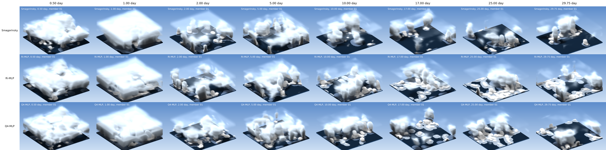
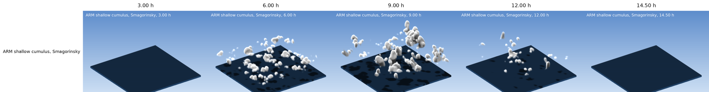
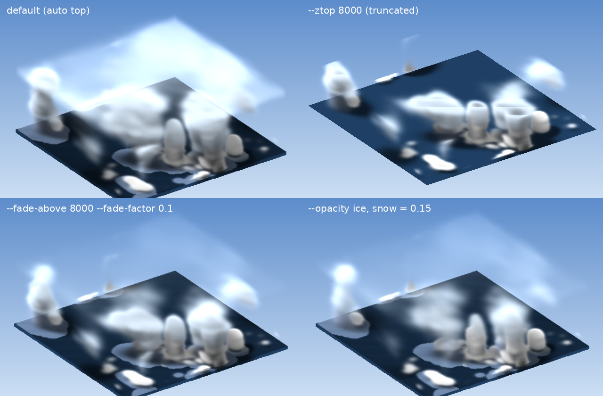

# monc-render3d

3-D cloud volume renders of MONC (Met Office NERC Cloud model) output.
It works straight from MONC's 3-D diagnostic NetCDF files and makes:

- single frames of any output record;
- movies (MP4 and GIF) of one run, or several runs side by side over their common output window;
- phase clips over chosen time windows;
- a snapshot grid (runs in rows, times in columns) from double-size stills, for posters and papers.

It needs only numpy, scipy, Pillow and netCDF4 (or h5py), plus ffmpeg for MP4. It does not need VTK, ParaView, a GPU
or a display, so it runs on login and compute nodes of HPC systems.

## Examples

RCE, 64 km x 64 km at 1 km grid spacing, 30 days. Three subgrid closures (Smagorinsky and two machine-learned
closures) side by side, one ensemble member each, at days 0.5 to 29.75. Condensate above 8 km is faded to 0.1 of
its extinction (`--fade-above 8000`), so the convection under the anvil shows. On days 0.5 and 1 an opaque layer of
snow and ice below 8 km fills the domain in all three runs; that is the model state, not the rendering:



ARM shallow cumulus, 9.6 km x 9.6 km at 50 m grid spacing, simple cloud scheme. Four records from one multi-record
output file, with the render top (1.5 km) chosen automatically from the data:



## What it renders

The renderer treats cloud condensate as a participating medium:

- **Extinction:** each condensate species gets a nominal mass extinction coefficient (1.5 / (rho_w r_e)). Effective
  radii are 10 um (cloud liquid), 30 um (ice), 250 um (snow) and 500 um (graupel and rain). So liquid cloud is
  opaque and anvil ice translucent. Mixing ratios are weighted by an exponential air density profile.
- **Lighting:** each voxel is lit by the sun, attenuated along the sun direction, plus a skylight term.
- **Image:** front-to-back compositing puts the clouds over a sky gradient and an ocean floor that carries the cloud
  shadows. The camera is oblique orthographic.
- **Colours:** they mark phase (white liquid, blue-white ice and snow, grey rain), not amounts. The renders show cloud
  structure qualitatively; they are not a quantitative diagnostic.

**Species:** the five MONC condensate fields (`q_cloud_liquid_mass`, `q_ice_mass`, `q_snow_mass`, `q_graupel_mass`,
`q_rain_mass`) are detected in each file. A simple-cloud or warm-rain run, or a reduced output list, just renders
fewer species. Other fields can be added with `--species NAME:KEXT`.

**What it reads from the files:** the record times (the time-dimension variable, so several records per file are
fine), the grid spacing (`x_resolution`, or the options database), the vertical coordinate (`zn`) and the domain size.

**Choices made automatically from the data:**
- **Render top:** the highest level with condensate, with a margin.
- **Vertical exaggeration:** raised for very flat domains so shallow cloud is resolved.
- **Floor:** drawn exactly when a thin floor would alias.

Horizontal boundaries are treated as periodic, as in most MONC set-ups (`--no-periodic` otherwise).

## Seeing under an anvil or upper stratus deck

An optically thick upper cloud deck hides the convection beneath it. Three ways to see underneath:

- **Truncate:** `--ztop H` renders only 0-H m. The default render top is the cloud top found in the data.
- **Fade:** `--fade-above H --fade-factor F` keeps the whole cloud but scales the extinction above H by F, reached
  over `--fade-depth` (default 1000 m).
- **Make species translucent:** `--opacity q_ice_mass=0.15 q_snow_mass=0.15` scales one species' extinction at all
  heights.

The same keys go in the `render` section of a configuration file.



RCE day 25, Smagorinsky, from top left: default; truncated at 8 km; faded above 8 km by 0.1; ice and snow at 0.15
opacity. Fading keeps the full cloud depth with the deck as a faint veil. Truncation shows the lower cloud most
clearly but cuts towers flat at H. Species opacity also dims the ice inside convective cores.

## Install

```bash
git clone https://github.com/pandasambit15/monc-render3d.git
cd monc-render3d
pip install .                    # or: pip install ".[video,fonts]" for a bundled ffmpeg and the DejaVu font
```

Without installing, run it from the clone as `python -m monc_render3d ...`.

## Quick start

```bash
# What does the tool see in a file?
monc-render3d inspect my_run/diagnostic_files/my_case_diagnostic_3d_3600.nc

# One frame (record 0 of the file)
monc-render3d frame my_run/diagnostic_files/my_case_diagnostic_3d_3600.nc -o frame.png --label "my case, 1 h"

# Movie, GIF and snapshot grid of one run (quote the glob)
monc-render3d run --files 'my_run/diagnostic_files/*diagnostic_3d*.nc' --labels "Control" -o renders --procs 8

# Several runs side by side (one --files per run), over the window they share
monc-render3d run --files 'smag/*_3d_*.nc' --files 'ml/*_3d_*.nc' --labels Smagorinsky ML -o compare --procs 8
```

The run step writes:
- `renders/frames/<run>/*.png`: one frame per record;
- `renders/stills/<run>/*_x2.png`: double-size stills;
- `renders/out/`: `movie.mp4`, `movie.gif`, `snapshots_grid.png` and any phase clips.

Frames already on disk are skipped, so a run can be resumed, extended or split across jobs:

```bash
monc-render3d plan ...           # write the job list and the product plan only
monc-render3d render renders     # render (e.g. in a batch job)
monc-render3d assemble renders   # movies, GIFs, grid
```

## Configuration files

For repeated or published figures, use a JSON configuration with `--config`. See `examples/compare_three_runs.json`:

| Key | Meaning |
|---|---|
| `runs` | List of `{key, label, files: [globs]}`, one panel each. A run continued over several folders is several globs; later matches replace earlier ones at the same time. |
| `title` | Text in the movie's title bar. Default: grid size, spacing and domain size from the files. |
| `tag` | Text appended to every panel label, e.g. `", member 01"`. |
| `window` | `common` (default): the longest unbroken stretch of output times all runs share. `union`: every output time, with "no output" panels where a run has none. |
| `stills`, `stills_days`, `stills_hours` | Times of the stills and of the snapshot-grid columns. |
| `stills_count` | Number of evenly spaced stills if no times are given (default 6). |
| `phases` | List of `{key, label, start, end}` in seconds, one clip each. |
| `time_unit` | `auto` (default), `s`, `min`, `h` or `day`, for labels. |
| `time_regex` | Read the time from the file name instead of opening every file (faster for thousands of single-record files). |
| `render` | Any render setting: `ztop`, `dz`, `nlevels`, `upsample`, `smooth`, `vexag`, `min_aspect`, `floor`, `azimuth`, `elevation`, `sun_azimuth`, `sun_elevation`, `size`, `periodic`, `species`, `opacity`, `fade_above`, `fade_factor`, `fade_depth`. |
| `stills_only` | Render only the stills and the snapshot grid, no movie (`--stills-only`). |

The same settings are command-line options; run `monc-render3d run --help`.

## Cost

**Per frame:** a 640 x 420 frame takes about 15-30 s and about 4 GB of memory on one core. The cost is set mostly by
the image size, not the model grid; grids from 32 x 32 to 256 x 256 have been rendered. A double-size still takes
about 25 GB.

**Memory sizing:** choose `--procs` from the node memory. Stills run with a quarter of the processes.

**Large runs:** split the frame list across batch-array tasks. Every entry in `jobs.json` is independent.

## Tested on

MONC 3-D diagnostics from:

- **RCE:** 64 x 64 x 99 at 1 km, CASIM with five condensate species, 30 days.
- **RCE at other resolutions and sizes:** 2 km (32 x 32), 500 m (128 x 128), and a 256 km x 256 km domain at 1 km.
- **ARM shallow cumulus:** 192 x 192 x 220 at 50 m, simple cloud scheme (liquid only), ten records per file.

There is also a synthetic MONC-layout test (`pytest tests`).

## Origin

Written for the 3-D cloud renders of an RCE closure comparison (Smagorinsky against machine-learned subgrid
closures). With the same settings (`render.ztop` 18000 m, as in `examples/compare_three_runs.json`), this version
reproduces a test frame of those renders byte for byte.
